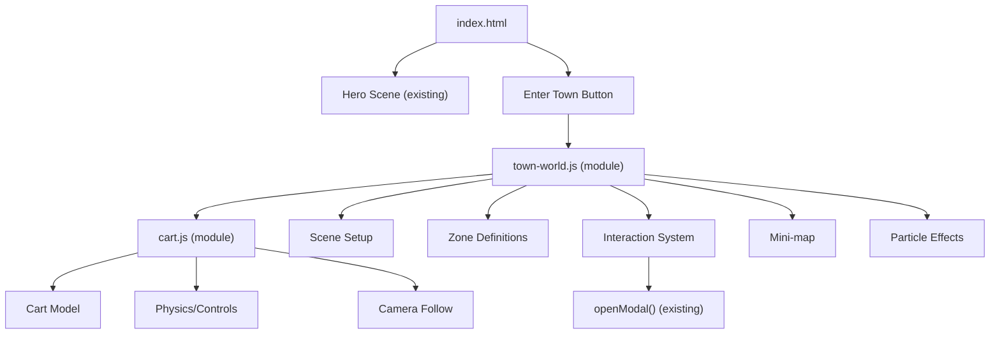

# 🏘️ Portfolio.md
### A 3D Isekai Town Experience

Welcome to the **Ayush Settlement**, an interactive 3D web experience built with modern JavaScript and a touch of another world. This project serves as a personal playground for exploring 3D environments, physics-based interactions, and Progressive Web App (PWA) features.

---

## 🌐 [Live Demo](https://ayushmaria.github.io/)

---

## Architecture Diagram



---

## 🚀 Current Status: Phase 1
We have successfully transitioned from a static void into a living settlement.

* **3D World Construction:** A fully rendered Isekai-style town environment.
* **The Cart System:** A physics-driven drivable cart implemented in `cart.js`.
* **Mobile Ready:** Full PWA support via `manifest.json`, making the settlement accessible as a standalone app.
* **Optimized Performance:** Cleaned up redundant files and streamlined CSS for faster rendering.

---

## 🛠️ Tech Stack
* **HTML5 / CSS3:** Custom styling including `town-styles.css`.
* **JavaScript (Vanilla):** Logic for world-building (`town-world.js`) and vehicle mechanics (`cart.js`).
* **Deployment:** Hosted via GitHub Pages / Vercel.

---

## 📂 Project Structure
* **`index.html`**: The entry point to the settlement.
* **`cart.js`**: Handles the steering, acceleration, and "cart-physics."
* **`town-world.js`**: The architect of the 3D town environment.
* **`town-layout.js`**: The plan of the hill town: hill, High Street and lanes, squares, river, stream and pools, wall and gates, portfolio buildings, filler townhouses, lamps, trees and the carved height field.
* **`terrain.js`**: The landscape mesh with streets painted into it, the river / stream / pools / falls, and the stone bridge.
* **`stadium.js`**: The Prediction Colosseum as a small football stadium (stands, pitch with an xG shot map, scoreboard, floodlights, a ball that rolls into the net).
* **`fan-square.js`**: Fan Square by the stadium (footballer statue, ticket kiosk, club flag, bunting, benches).
* **`control-tower.js`**: Navigator's Tower as an airfield control tower (glazed cab, radar, aviation light, windsock), plus the waypoint drone and flags.
* **`vortex-observatory.js`**: the Vortex Observatory (dome, telescope, anemometer), the teal vortex with its detection box, and the streamlines round its foot.
* **`cloud-citadel.js`**: the Cloud Citadel (master and worker towers, walkways, cloud bank, window rows computing a matrix).
* **`drone-forge.js`**: The Forge (MAVPose) as a kaji-ba: a swordsmith's smithy beside a drone workshop, the landing pad on its roof deck, and the pad drone's flight.
* **`concierge-parlour.js`**: Ace's Concierge Parlour (octagonal pavilion, verdigris dome, chat-bubble lantern, booking board, pigeons).
* **`counting-house.js`**: the Tally Bridge Counting House (vault house, counting room, skybridge on arches, scrolls and letters on the line, balance scale).
* **`tiny-tots.js`**: Tiny Tots Academy (storybook schoolhouse with clock, bell cupola and access ramp; playground with slide, swing, rainbow gate and kites).
* **The forest**: `buildLandingTrees()` in `town-props.js` draws the landing page's cedars and maples, scattered by `town-layout.js` over every open space.
* **`colliders.js`**: Collision shapes shared by the cart and the knockable props (circles, rotated boxes, capsules, the play-area ring).
* **`town-props.js`**: Mill wheel, clock tower, trees, clouds, mountains, stalls.
* **`castle-wall.js`**: The town wall as an ishigaki castle wall: battered stone base, white plaster parapet, yagura towers, a roofed gate and the water gate.
* **`machiya.js`**: The filler buildings as Kyoto townhouses (machiya): every townhouse, plus the Tavern, Mill, Guild Board and Adventurer Stats.
* **`street-orbs.js`**: The street lights: armillary orbs floating over the streets, with halos.
* **`gissha.js`**: The cart you drive: a Heian court carriage (gissha) on two great wheels, with small steering wheels under the shafts and a swinging paper lantern.
* **`textures.js`**: Procedural canvas textures (cobbles, plaster, roof tiles, stone, windows).
* **`achievements.js`**: Exploration tracking, achievements and toasts.
* **`docs/town-map.svg`**: Top-down reference map of the town (contours, water, streets, wall, buildings, townhouses, lamps, trees), drawn from `town-layout.js`. Regenerate with `node tools/make-town-map.mjs` after changing the plan.
* **`wind.js`** / **`grass.js`**: Shared wind field, leaf-card foliage helpers and grass blades (see `docs/wind-foliage-guide.md`).
* **`implementation_plan.md`**: Our roadmap for future town expansions.
* **`assets/`**: The link-preview card (`og-preview.jpg`, 1200 × 630) shown when the site is shared, and the icons (favicon, home-screen and app icons: an armillary orb like the street lights). The Open Graph and Twitter tags in `index.html` point at the preview with an absolute URL, because link crawlers don't run JavaScript or resolve `./` paths.

---

## 🏗️ Getting Started
If you'd like to run this settlement locally:

1. **Clone the repo:**
   ```bash
   git clone [https://github.com/AyushMaria/ayushmaria.github.io.git](https://github.com/AyushMaria/ayushmaria.github.io.git)

---

## Open the gates:
Simply open index.html in your favorite browser (or use a Live Server extension in VS Code for the best experience).

---

## 🗺️ Roadmap
[x] Phase 1: 3D Town & Drivable Cart.
[x] Phase 2: Isekai Aesthetic Upgrades.
[ ] Phase 3: Interaction System.
